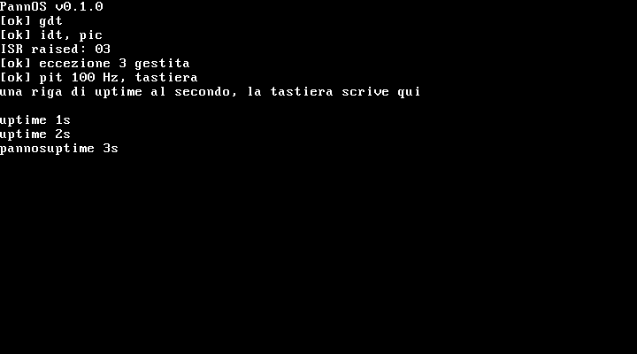

# PannOS

Toy OS kernel bare-metal per x86 (i686, 32 bit), scritto in C con il minimo
indispensabile di assembly. Il nome viene da **Pannone**, il paese dove abita l'autore,
più "OS". Progetto per [Stardance](https://hackclub.com) (Hack Club), nato per imparare
come funziona davvero una macchina, un pezzo alla volta.



## Cosa c'è (v0.1.0)

- Boot con **Multiboot2** + GRUB
- Driver **VGA** text mode (scroll, backspace)
- **GDT** flat
- **IDT**, eccezioni CPU 0-31 con stub in assembly e handler in C
- **PIC 8259** rimappato, 16 IRQ hardware con EOI
- **PIT 8253** a 100 Hz con contatore di tick, uptime stampato ogni secondo
- Tastiera **PS/2** (IRQ1, scancode set 1, layout US, shift)
- Porta **seriale** COM1: tutto quello che va a schermo esce anche lì

Un'eccezione diversa dal breakpoint (`int 3`) è considerata fatale: il kernel stampa il
numero e si ferma, invece di rieseguire all'infinito l'istruzione che ha fallito.

## Compilare

Serve un cross-compiler `i686-elf-gcc`. Lo script lo compila da sorgente (binutils 2.41,
gcc 13.2.0, ci mette un po') e installa in `~/opt/cross`:

```bash
sudo apt install build-essential nasm xorriso grub-pc-bin qemu-system-x86 \
    libgmp-dev libmpfr-dev libmpc-dev texinfo
./setup-toolchain.sh
export PATH="$HOME/opt/cross/bin:$PATH"
make
```

## Avviare

```bash
make run            # finestra QEMU
make run-headless   # senza finestra, output sul terminale via seriale
```

Oppure, con l'ISO già pronta dalla pagina delle release:

```bash
qemu-system-i386 -cdrom pannos.iso
```

## Limiti noti

- Solo 32 bit.
- Provato solo su QEMU, non su hardware vero.
- Nessuna gestione della memoria, nessun processo, nessun user mode: oggi il kernel
  gira, conta il tempo e legge la tastiera.

## Roadmap

5. Memory management: physical memory manager sulla memory map Multiboot2, poi paging
6. Kernel heap (`kmalloc`/`kfree`)
7. Multitasking: context switch e scheduler round-robin
8. User mode e syscall (TSS, ring 3)
9. Filesystem minimo (initrd), loader ELF, shell in user mode
10. Stretch: x86_64, SMP, framebuffer VBE, rete

## Licenza

MIT, vedi [LICENSE](LICENSE).
